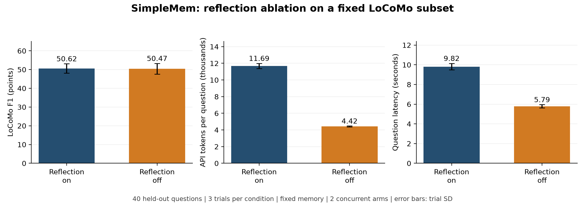

# SimpleMem 正式复现实验与反思消融结果

日期：2026-11-09。完成 40 道固定题目 × 2 种配置 × 3 轮，共 240 次问题运行。

## 主要结果

| 指标（3 轮均值 ± 样本标准差） | 开启反思 | 关闭反思 |
|---|---:|---:|
| LoCoMo 官方规则 F1（0–100 分） | 50.62 ± 2.53 | 50.47 ± 2.86 |
| 作者原始 set-token F1（0–100 分） | 41.27 ± 1.77 | 40.83 ± 2.85 |
| 每题全部 API token | 11691.64 ± 306.73 | 4418.64 ± 59.65 |
| 每题 API 请求次数 | 6.07 ± 0.06 | 4.00 ± 0.00 |
| 每题检索与回答时间（秒） | 9.82 ± 0.33 | 5.79 ± 0.17 |

关闭反思的 F1 相对开启反思变化为 -0.15 分；每题 token 变化为 -62.2%，API 次数变化为 -34.1%，耗时变化为 -41.0%。
按题目先平均 3 轮，再对 40 道题进行 10,000 次成对 bootstrap，关闭减开启的 F1 条件区间为 [-3.52, +3.06] 分。
这是固定这一组对话与这一份记忆的描述性区间，不是整个 LoCoMo 总体的置信结论，也不包含记忆构建的随机性。

## 分类结果

| 类别 | 开启反思 F1（分） | 关闭反思 F1（分） |
|---|---:|---:|
| 1：多跳 | 32.22 ± 5.46 | 29.04 ± 1.56 |
| 2：时间 | 73.42 ± 3.60 | 74.24 ± 4.19 |
| 3：开放域 | 28.46 ± 1.43 | 28.34 ± 1.40 |
| 4：单跳 | 68.38 ± 1.78 | 70.26 ± 4.73 |

## 用量与执行核对

共 1,208 次 API 请求，输入 1,803,810 token，输出 129,424 token，总计 1,933,234 token；缓存输入 624,376 token。
正式实验按官方空闲/高峰费率估算 1.7096–3.4192 元，未超过正式实验 9 元上限；另预留 1 元覆盖此前试跑与连通样例，总预算上限 10 元。
这是价目表估算，不是平台账单。未知费用预留为 0.0000 元。
失败或未知用量的 API 请求 0 次；标记失败的问题运行 0 次。失败运行计 0 分，没有删除失败题。
检查完成 240 个唯一的题目/轮次/配置组合，类别和题数符合预定设计；逐题用量与持久账本完全相符。
实验前后 454 条记忆的内容和 ID 完全一致；没有重新构建记忆或读取答案标注进行检索。

## 条件与复现范围

- 使用 SimpleMem 作者提交 db80b6a 的文本路径，并保留已记录的本地兼容调整；运行版本和参数见 run_metadata.jsonl。
- 使用 DeepSeek Flash，关闭模型 thinking；系统 planning 开启。两组唯一主动改变的系统设置为 reflection 的开关；开启时最多两轮补充检索。
- LoCoMo 第一组对话 conv-26 的完整 419 轮对话，压缩得到试跑阶段的 454 条结构化记忆。正式题目按四个类别各抽 10 题，排除全部 8 道用量试跑题；选题在实验前固定，没有根据正式结果调整。
- 检索模型为 Qwen3-Embedding-0.6B，CPU，4 个线程；两组在每题上同时运行，每组内部检索串行。时间包含共享机器上的固定两组并发负载，不能当作单请求独占机器的时延。
- 每次模型请求输出上限 4096 token，SDK 自动重试关闭，单次超时 90 秒；作者自身的重试逻辑保留且所有请求计费记录在账本中。
- 主要评分按固定版本 LoCoMo 官方规则，辅助评分复用 SimpleMem 原脚本规则；都不代表人工语义正确率。
- 每轮 40 题结果先汇总，再对三轮计算均值和样本标准差；由于各类别题数相等，整体平均也等于四类宏平均。

## 与论文报告的对照

SimpleMem 论文 Table 1 使用 GPT-4.1-mini 的全量结果为：多跳 43.46、时间 58.62、开放域 19.76、单跳 51.12，四类平均 F1 43.24。
本次开启反思的子集结果为 50.62 分，模型、题目分布与代码版本均不同；仅作为条件不同的对照，不能据此宣称复现了该数值或超过论文。
本次 token 统计包含全部检索规划、反思和最终回答的 API 用量，不能未经口径核对就与论文的 token 数字计算节省倍数。

## 结果文件与来源

- questions.csv / questions.jsonl：每个问题运行的原始答案、参考、双评分、时延、用量与失败标记。
- trials.csv：两组各三轮的汇总；categories.csv：分类结果；paired_questions.csv：按题目平均后的成对比较。
- api_ledger.jsonl：每个 API 请求前的预算预留与返回用量，支持核对失败和中断支出；不包含密钥。
- run_metadata.jsonl：固定选题、协议、代码提交、数据和记忆校验值、运行状态。
- analysis.jsonl / comparison.png / comparison.svg：统计结果与可导出图表。
- [论文](https://arxiv.org/html/2601.02553v3)，[SimpleMem 代码](https://github.com/aiming-lab/SimpleMem)，[LoCoMo 评分来源](https://github.com/snap-research/locomo/blob/3eb6f2c585f5e1699204e3c3bdf7adc5c28cb376/task_eval/evaluation.py)，[官方人民币价格](https://api-docs.deepseek.com/zh-cn/quick_start/pricing/)。

## 如何解读

本子集的主要观察是：关闭反思明显减少了 token 与请求次数，平均 F1 只下降 0.15 分。成对区间跨越 0，因此不能据此认定质量有确定提升或证明质量完全不受影响。
10 道题的三轮平均 F1 在关闭反思后较高，8 道较低，22 道相同；有些题确实从补充检索中受益。

例如问题 24 问 Melanie 如何减压，参考是 Running, pottery。第一轮关闭反思只回答 She runs.（F1 0.333），开启反思包含 running 和 pottery（F1 1.000），但同时列出了更多活动。
问题 32 问 Caroline 参加过哪些 LGBTQ+ 活动：第一轮开启反思的答案更长，列出很多活动和日期，F1 为 0.340；关闭反思答案较短，F1 为 0.600。这里分数变化同时受检索内容和词语匹配方式影响。
LoCoMo 的多答案评分按每个参考子答案取预测中的最佳匹配，对额外列出的答案项惩罚有限。F1 不是人工语义正确率，满分也不保证每个额外细节都正确。
本次未增加付费语义裁判；保留全部原始回答，供报告中的定性分析与人工检查。

## 恢复同一份记忆并重新运行

本目录还包含 fixed_memories.jsonl、memory_db_snapshot.zip 和 snapshot_manifest.jsonl，保留本次固定的文本记忆、检索向量和索引；都是公开基准衍生数据，不含密钥。
在新的检出目录完成依赖、配置、数据与检索模型准备后，运行 `.venv/bin/python reproduction/restore_formal_memory.py` 恢复完全相同的记忆，再运行 `.venv/bin/python reproduction/run_formal.py`。恢复记忆本身不调用大模型 API。
`reproduction/analyze_formal.py` 可以离线重新生成本页、表格和图。本文的定性解释段是核查本次原始回答后添加的说明。
