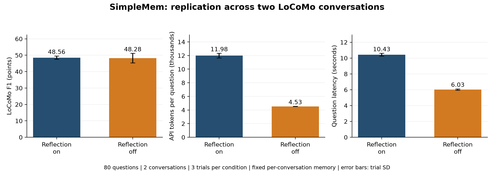

# Independent conversation replication and combined results

The original result is retained separately. An additional complete long conversation was evaluated with the same settings, then both results were combined.

## Scope

- conv-26: 419 turns, 40 questions, two arms x three trials = 240 question-runs.
- conv-49: 509 turns, 40 questions, two arms x three trials = 240 additional runs.
- Total: two conversations, 80 distinct questions, 480 runs. Each conversation has ten questions per category 1-4.
- The extension selected the shortest unused eligible conversation by dialogue-plus-caption characters, requiring at least ten answered questions per category. This cost rule and question selection were fixed before new answer scores existed.
- DeepSeek Flash; thinking off; planning on; two concurrent arms; four CPU threads; 4096 output tokens/request. Only reflection differs between arms.

## Results by conversation and combined

| Scope | Reflection on F1 | Reflection off F1 | Off minus on, points | Token reduction | Latency reduction |
|---|---:|---:|---:|---:|---:|
| Original: conv-26 | 50.62 | 50.47 | -0.15 | 62.2% | 41.0% |
| Extension: conv-49 | 46.49 | 46.08 | -0.41 | 62.1% | 43.1% |
| Combined | 48.56 | 48.28 | -0.28 | 62.2% | 42.1% |

Scores are means across three trial aggregates, not correctness rates. Equal question counts give both conversations equal weight.

## Combined variability and limits

Category-aware LoCoMo F1, mean +/- trial sample SD: reflection on 48.56 +/- 1.04; reflection off 48.28 +/- 2.91.
After averaging trials per question, 10,000 paired question bootstrap samples give [-2.55, +1.94] F1 points for off minus on, conditional on these two fixed conversations and memories. This is not a population interval or non-inferiority proof. The cost-selected extension and once-built memories limit generalization.
Timing is measured with both arms running concurrently; runtime periods may also affect absolute cross-conversation latency. Lexical F1 is not semantic correctness; original set-token F1 and all raw answers are retained.

## Extension usage and checks

Construction plus queries: 1224 API calls, 2,135,868 tokens; 14 build calls and 1210 query calls.
Estimated price-list cost: CNY 2.1193-4.2386, including build and queries under the same CNY 4.5 extension cap. Prior experiments are outside this cap. This is not an invoice; unknown reservations are CNY 0.0000.
Failed/unknown API calls: 0; failed questions: 0. All 240 extension tuples are complete, per-question usage matches the ledger, and memory content/IDs are unchanged.

## Files and references

- `condition_summary.csv`: per-conversation and combined means/sample SDs.
- `questions.csv`: all 480 original and extension answers, references, scores and usage.
- `questions.jsonl` / `api_ledger.jsonl`: raw extension answers and persistent cost ledger.
- `run_metadata.jsonl` / `build_summary.jsonl`: fixed settings and build provenance.
- [Original result](../formal-20261109/RESULTS.md), [LoCoMo](https://github.com/snap-research/locomo), [official pricing](https://api-docs.deepseek.com/quick_start/pricing/).

## Interpretation

Token savings were approximately 62.2% and 62.1% in the two conversations. Mean F1 decreased by 0.15 and 0.41 points respectively, or 0.28 points combined. The efficiency pattern therefore appeared again in an independent conversation, conditional on this setup. The interval crosses zero and does not prove non-inferiority or universal superiority. The extension strengthens the coursework analysis but remains far smaller than the full benchmark.

## Extension debug diary

The first local query startup check still searched for the original conversation's speaker, Caroline, and failed on the new database. No extension evaluation-question API calls had been sent. All 14 completed memory-build calls, the resulting database and the persistent ledger were retained.

The warmup keyword was changed to the current conversation's `speaker_a`. This affects only an untimed local health check, not the fixed questions, scoring, model settings or arm difference. The corrected code version and protocol were saved before question trials began. Offline checks verified the 8192-token construction reservation and concurrent budget protection. The local startup failure is distinguished from API failures; no incomplete question was reported as completed.

## Restoration and replay

`fixed_memories.jsonl`, `memory_db_snapshot.zip` and `snapshot_manifest.jsonl` preserve the same 540 benchmark-derived memories and vectors/indexes, without credentials. After environment, data and model setup, run `.venv/bin/python reproduction/restore_replication_memory.py` to restore without paid construction. Use `reproduction/run_replication.py` for a paid question replay, or `reproduction/analyze_replication.py --archived` for offline combined analysis.

The original first-conversation results and fixed designs remain intact. An independent paid repeat should use a separate checkout and preserve its own persistent ledger. The current completed local tuples are skipped. Only metered tokens and price-list cost estimates are published, never API credentials or account balances.
