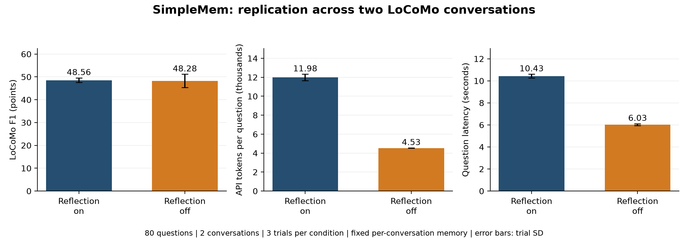

# Reproducing SimpleMem on a Budget
## A controlled reflection ablation on two LoCoMo conversations

FTEC5660 - Reproducibility Work | 9 November 2026

Prepared for GitHub account: **garyWang2026**

### Abstract

This study runs the authors' SimpleMem text-memory pipeline and tests one isolated modification: disabling reflective retrieval while retaining planning. The target behavior is answering questions from compressed, persistent memories of long conversations. The original GPT-4.1-mini paper result is a contextual reference; this study uses DeepSeek Flash and a deliberately limited LoCoMo subset.

Two complete conversations yield 80 distinct evaluation questions, balanced across four categories. Three trials of each condition produce 480 question-runs. With reflection enabled, category-aware LoCoMo F1 is 48.56 points; disabling reflection yields 48.28 points. The modification reduces API tokens per question by 62.2% and measured retrieval-plus-answer time by 42.1% under a fixed two-arm concurrent workload. The conditional paired interval for the F1 change crosses zero, so these results do not establish non-inferiority or broad superiority.

The pipeline behavior is reproducible under the documented local setup: memories can be constructed, persisted, restored and queried. Exact reproduction of the paper's full-benchmark number is not claimed. Raw answers, both lexical scores, usage ledgers, frozen protocols and reusable memory snapshots are included in the repository.

### Study at a glance

| Item | Measured scope |
|---|---|
| System | SimpleMem text pipeline; no Omni/EvolveMem experiments |
| Task | Long-conversation question answering on LoCoMo |
| Controlled modification | Reflection on versus reflection off; planning retained |
| Evaluation | 2 conversations, 80 unique questions, 3 trials per arm |
| Completed runs | 480; zero failed question-runs and zero API failures |
| Primary finding | Large token reduction, small observed mean lexical F1 decrease |

The conclusion concerns an efficiency-quality tradeoff in two fixed conversations. F1 is token overlap, not the percentage of answers that are correct.

<!-- pagebreak -->

# 1. Target, provenance and setup

SimpleMem converts dialogue windows into structured memories, persists them in a searchable store, plans retrieval for a question, optionally reflects on missing information and generates an answer. Its multi-step memory and retrieval loop makes it an agentic system rather than a single prompt-response call.

The reproduction target is the claimed capability to answer long-conversation questions using compressed memories, measured by answer F1 and resource use. The isolated modification removes the reflection step's supplementary retrieval. It does not remove memory or the planner. The DeepSeek substitution is shared by both arms and is documented separately from the ablation.

### Pinned sources

| Component | Version or provenance |
|---|---|
| SimpleMem | aiming-lab/SimpleMem, commit db80b6a (full hash in provenance.json) |
| Download verification | 461 upstream files matched before local changes |
| LoCoMo data and scorer | snap-research/locomo, commit 3eb6f2c |
| Embedding | Qwen/Qwen3-Embedding-0.6B; official ModelScope files, SHA-256 checked |
| Runtime | Python 3.13.2, Apple Silicon arm64, torch 2.6.0, transformers 4.57.0 |
| Storage/search | LanceDB backend; installed versions in requirements-lock.txt |

The dataset SHA-256 is `79fa87e90f04081343b8c8debecb80a9a6842b76a7aa537dc9fdf651ea698ff4`. Complete commit hashes and individual embedding-file hashes are in `reproduction/provenance.json`. The upstream license, attribution and multilingual documentation are retained.

### Model and execution settings

The hosted model was `deepseek-flash` at `https://api.deepseek.com`. Thinking and streaming were disabled. No provider seed or explicit top-p override was set. Temperatures follow the original task-specific prompts: memory construction 0.1; information requirements 0.2; targeted and missing-information queries 0.3; keyword/structured analysis, reflection completeness and final answers 0.1. Prompts were retained.

Per-request output caps were 8192 tokens for memory construction and 4096 for retrieval/answers. SDK retries were zero and timeout was 90 seconds for formal queries; original application retry logic remained metered. Reflection on permitted at most two supplementary rounds. Embeddings ran on CPU with four threads. Both conditions share these settings. The hosted alias is not an immutable model snapshot, so future runs may differ even with the same code and data.

<!-- pagebreak -->

# 2. Experimental design and metrics

First, a synthetic end-to-end smoke test built two memories and correctly returned Shanghai in 8.79 seconds, excluding initialization. An eight-question conv-26 pilot measured usage and produced 454 memories from all 419 turns. The pilot was for setup and budgeting; its answers are not included in formal F1.

### Fixed evaluation sets

| Conversation | Input turns | Fixed memories | Unique evaluation questions | Question-runs |
|---|---:|---:|---:|---:|
| conv-26 | 419 | 454 | 40 | 240 |
| conv-49 | 509 | 540 | 40 | 240 |
| Total | 928 | 994 | 80 | 480 |

Each conversation contributes ten questions from each of categories 1-4: multi-hop, temporal, open-domain and single-hop. Category 5 is outside scope. The full dataset contains ten conversations and 1,986 questions; this is a small subset. All eight pilot questions were excluded from formal conv-26 evaluation. Selection seed was 5660; conv-49 used 5662. Trial schedule seeds were 5661 + trial and 5663 + trial respectively.

The extension selected the shortest unused eligible conversation by dialogue-plus-caption character count (67,517), requiring at least ten answered questions in every selected category. This cost rule was fixed before extension scores existed. It is not random conversation sampling. Question indices and settings are frozen in the tracked protocol/plan files.

Both arms and all trials share one fixed memory database per conversation. Only dialogue and existing captions are used to build memories, not QA gold answers or evidence annotations. Memory contents and IDs were verified unchanged at the end. The two arms run concurrently for each question; retrieval within an arm is sequential and CPU embedding calls are serialized. Latency therefore describes paired load on one machine, not isolated request speed.

### Scoring and aggregation

The primary metric follows the pinned official LoCoMo category-aware lexical F1 rules: normalize punctuation, remove a/an/the/and, apply Porter stemming and count token multiplicity. Category 1 splits comma-separated reference subanswers and averages best matches; category 3 uses the reference before the semicolon; categories 2/4 use direct scoring. The original SimpleMem set-token F1 is a secondary sensitivity check.

For each arm, calculate a mean over all questions in a trial, then the mean and sample standard deviation across three trials. Balanced categories make the overall mean equal to their macro-average. Failed questions remain with zero scores and are counted separately. The paired bootstrap first averages three trials per question, then resamples 80 question differences 10,000 times with seed 5664. Its interval is conditional on these conversations and fixed memories.

<!-- pagebreak -->

# 3. Measured results

### Primary F1 by conversation

| Scope | Reflection on, F1 points | Reflection off, F1 points | Off minus on |
|---|---:|---:|---:|
| conv-26 | 50.62 +/- 2.53 | 50.47 +/- 2.86 | -0.15 |
| conv-49 | 46.49 +/- 1.58 | 46.08 +/- 2.99 | -0.41 |
| Combined | 48.56 +/- 1.04 | 48.28 +/- 2.91 | -0.28 |

Values are mean +/- sample SD across three trial aggregates, in points on a 0-100 scale. They are not correctness percentages. The combined conditional paired bootstrap interval for off minus on is **[-2.55, +1.94] points**. It includes zero and does not prove that disabling reflection preserves quality.

### Combined quality and resource use

| Measure per question | Reflection on | Reflection off |
|---|---:|---:|
| Original set-token F1, points | 43.86 +/- 0.55 | 43.45 +/- 2.64 |
| All API tokens | 11,984.43 +/- 343.00 | 4,534.45 +/- 19.32 |
| API calls | 6.08 +/- 0.08 | 4.00 +/- 0.00 |
| Retrieval-plus-answer time, seconds | 10.43 +/- 0.18 | 6.03 +/- 0.08 |

Disabling reflection reduced tokens by **62.16%**, calls by **34.16%** and measured latency by **42.13%**. The efficiency pattern appeared in each conversation separately: token reductions of 62.21% and 62.12%. No API call had failed/unknown usage, and no question-run was marked failed. All 480 prescribed question/trial/condition tuples were present exactly once.

<!-- pagebreak -->

# 4. Interpretation and comparison to the paper

The main observation is a repeated reduction in retrieval/answer overhead after disabling reflective retrieval. Reflection-on uses about two additional API calls per question on average. In this setup, these extra calls add substantial tokens and elapsed time while yielding a small positive mean F1 difference. The secondary set-token score points in the same direction, but its lower absolute values show that metric choice matters.

### What comparison is justified?

| Table 1 reference | Multi-hop | Temporal | Open-domain | Single-hop | Macro F1 |
|---|---:|---:|---:|---:|---:|
| Paper: GPT-4.1-mini | 43.46 | 58.62 | 19.76 | 51.12 | 43.24 |
| This study: DeepSeek, reflection on | - | - | - | - | 48.56 |

The paper number is a contextual reference, not a matched baseline. This study uses a different model, only two conversations, balanced question sampling, a newer source snapshot and documented score handling. Its higher observed macro F1 does not establish that it reproduces or exceeds the paper's result. All planning, reflection and answer API tokens are included here; cross-paper token ratios would require matching accounting definitions.

### Examples from raw answers

For conv-26 question 24, the reference stress-relief activities are "Running, pottery". In trial 1, reflection off answered "She runs." and scored 0.333; reflection on included both reference activities and scored 1.000. This is a concrete case where supplementary retrieval recovers missing content, although the longer answer also listed extra activities.

For conv-26 question 32, asking which LGBTQ+ events Caroline attended, reflection on produced a longer list with dates and scored 0.340, while reflection off produced a shorter answer and scored 0.600. The difference mixes retrieval content with lexical scoring effects. Extra listed answers are weakly penalized by the category-aware multi-answer scorer. A high F1 is therefore not evidence that every extra statement is true.

### Limits of the evidence

Only two conversations were tested, and the extension was selected for cost rather than population representativeness. Questions within a conversation are correlated. The bootstrap is descriptive conditional on fixed conversations; it does not capture conversation sampling or memory-construction uncertainty. Three trials characterize some answer variability but not a full distribution of possible outcomes.

Each memory was built once and then shared. Category 5, other benchmarks, multimodal operation and other LLMs were not evaluated. No semantic judge or comprehensive manual factuality audit was added. Provider changes, cache state and run time can affect future outputs or latency. The results support a local efficiency-quality tradeoff, not a universal recommendation to remove reflection.

<!-- pagebreak -->

# 5. Costs, safeguards and debug diary

### Metered expenditure

| Phase | API calls | Total tokens | Estimated CNY, off-peak to peak |
|---|---:|---:|---:|
| Eight-question pilot, including first memory | 63 | 196,785 | 0.3789-0.7578 |
| conv-26 formal questions | 1,208 | 1,933,234 | 1.7096-3.4192 |
| conv-49 build and questions | 1,224 | 2,135,868 | 2.1193-4.2386 |
| Total metered phases | 2,495 | 4,265,887 | 4.2078-8.4156 |

The extension includes 14 build calls and 1,210 query calls. Its memory construction used 104,572 tokens and took 223.99 seconds. The table excludes initial connectivity and synthetic smoke checks, whose usage was not fully included in this ledger. These are price-list estimates based on returned usage, not platform invoices. Account balances and API keys are not published.

Rates checked on 9 November 2026 were CNY 0.02 cached input, 1 uncached input and 4 output per million tokens off-peak, with peak prices double. The original formal question phase stayed below its CNY 9 cap, with CNY 1 reserved for earlier checks. The extension stayed below its separate CNY 4.5 cap, including construction. No cap was increased during execution.

Before each request, a persistent ledger reserves a conservative peak-price upper cost using input byte count, template overhead and maximum output. Unknown or interrupted usage retains its reservation. Insufficient budget stops further requests and preserves partial results. Restarting reuses the same ledger, and completed question tuples are skipped. This limits accidental overspending and hidden retry costs.

### Main blockers and resolutions

| Blocker | Resolution and consequence |
|---|---|
| Missing dataset in downloaded code | Download pinned LoCoMo data and verify SHA-256 |
| HTTPS certificate failures | Use macOS system certificates without disabling TLS verification |
| Missing keyword index dependency | Install pylance 0.39.0; repeat backend checks |
| Hugging Face timeout | Fetch official Qwen ModelScope files and verify publisher hashes |
| Metal/MPS shape-inference crash | Add optional device configuration; use the same CPU path in both arms |
| Provider thinking default | Add an explicit thinking toggle; disable thinking in both arms |
| Old speaker used in extension warmup | Use current speaker; retain completed build and budget ledger |

The warmup failure was local and occurred before any extension evaluation-question API calls. The 14 build calls were retained rather than repeated. It is recorded separately from the zero API failure count. Compatibility and budget checks were performed offline; no failed or interrupted question was silently removed from the evaluation.

<!-- pagebreak -->

# 6. Reproduction guide and conclusion

The root README links to the coursework guide. `reproduction/README.md` gives environment installation, key setup, pinned downloads and commands. Credentials reside only in ignored local `.env`; root `config.py`, environments, model weights and temporary run folders are excluded from Git.

### Three ways to use the repository

1. **Inspect without paid calls.** Read the tracked result reports, raw answers, usage ledgers and figures. The complete combined table contains 480 question-runs. No API key or model download is needed merely to read the evidence.
2. **Recompute statistics offline.** After installing dependencies, run `reproduction/analyze_formal.py --archived` and `reproduction/analyze_replication.py --archived`. The archive mode reads tracked evidence, not missing ignored local run folders.
3. **Repeat retrieval and answers.** Configure the documented environment and provider, download pinned data and embeddings, restore both memory snapshots using the supplied helpers, then run the formal and replication runners in a separate checkout. Restoring snapshots is offline; question generation incurs new API charges. Recheck current pricing and model availability first.

Each result directory includes `questions.jsonl`, a request ledger, runtime/protocol metadata, memory contents, a database snapshot and a checksum manifest. The combined directory also includes a 480-row question CSV and condition summary. The snapshots retain the exact recorded memories, vectors and indexes, making fixed-memory replay possible without paying for reconstruction. Local Git history distinguishes compatibility work, fixed protocols, execution fixes and completed results; publication should preserve that history.

### Conclusion

SimpleMem's text-memory workflow ran successfully under the documented DeepSeek/CPU setup and produced measurable question-answering behavior from persistent long-dialogue memories. The reflection-off ablation repeated a roughly 62% token reduction in a second conversation, with a combined observed F1 decrease of 0.28 points and a conditional interval spanning zero. This is a useful, bounded reproduction of behavior and a controlled modification; it is not a replication of the paper's full-benchmark score.

A stronger follow-up would sample more independent conversations, rebuild memory across trials and evaluate factual correctness alongside lexical F1. For the present budgeted study, the priority is a transparent account of what ran, what changed and what the evidence supports.

### References

[1] SimpleMem: Efficient Lifelong Memory for LLM Agents. Paper, version 3. https://arxiv.org/html/2601.02553v3

[2] SimpleMem authors' repository. https://github.com/aiming-lab/SimpleMem (source commit and attribution preserved in provenance.json).

[3] LoCoMo data and category-aware evaluation. https://github.com/snap-research/locomo/tree/3eb6f2c585f5e1699204e3c3bdf7adc5c28cb376

[4] DeepSeek API price list, checked 9 November 2026. https://api-docs.deepseek.com/quick_start/pricing/

[5] Qwen official embedding distribution. https://modelscope.cn/models/Qwen/Qwen3-Embedding-0.6B
